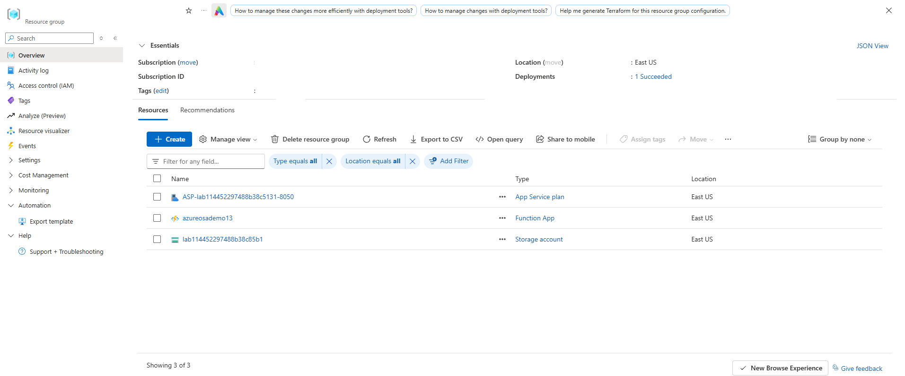
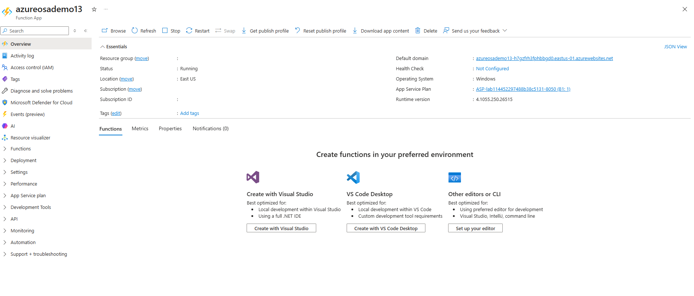
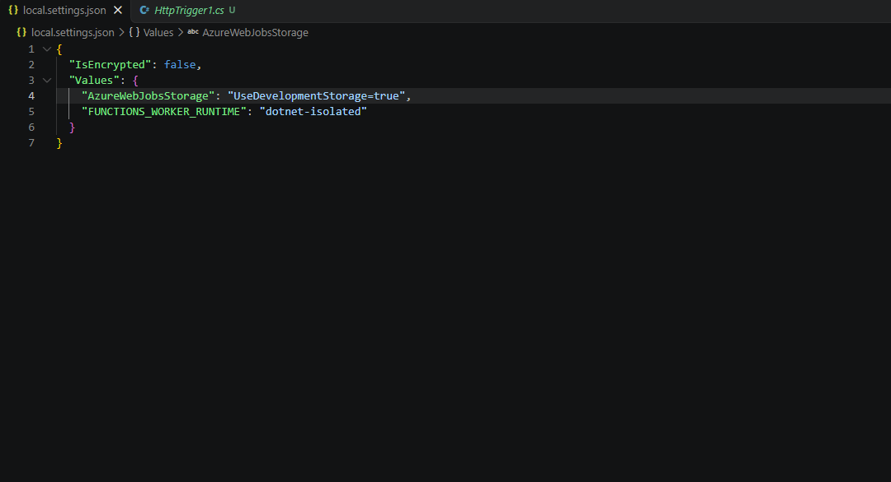
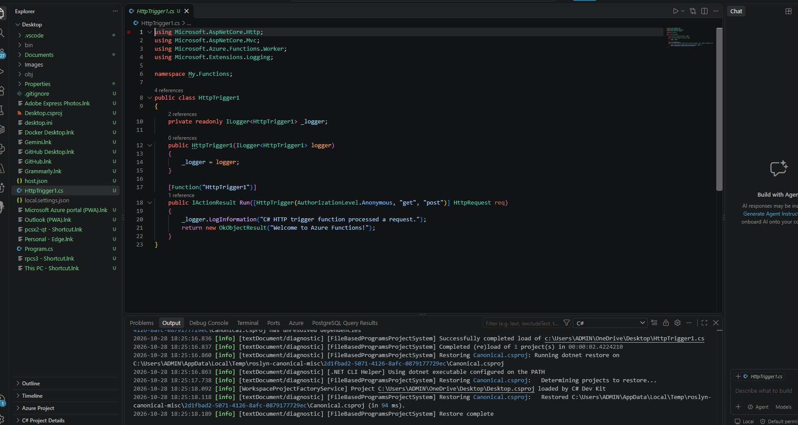
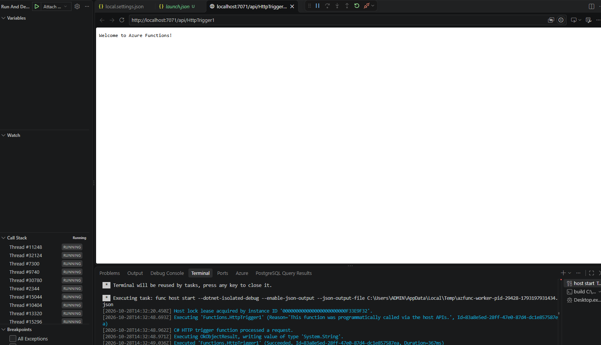
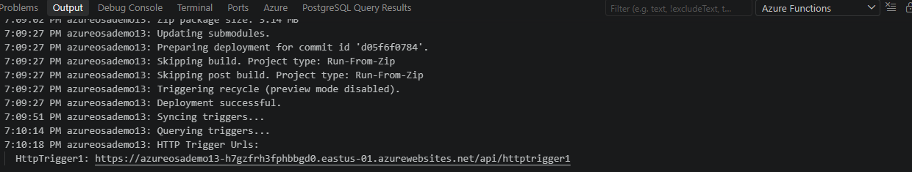
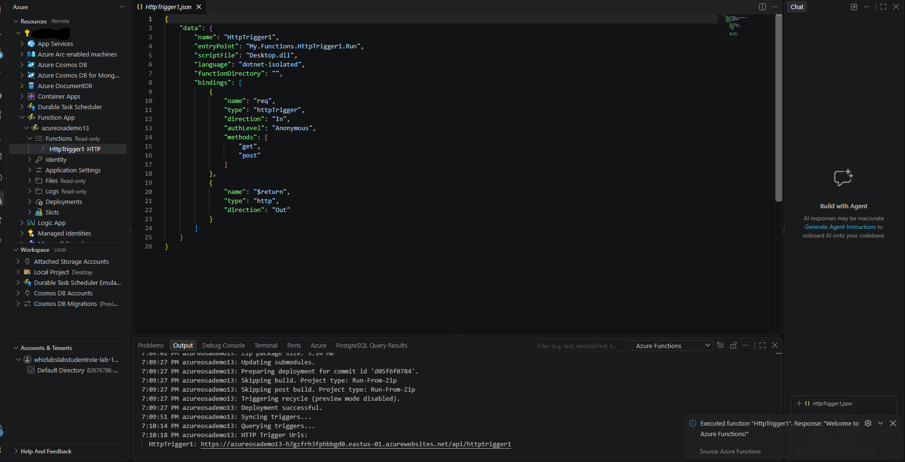
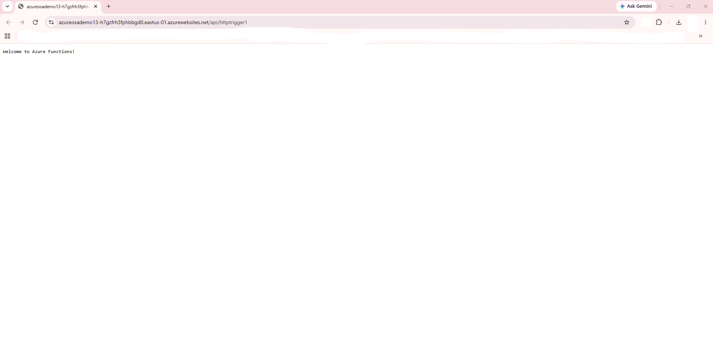

# Create a C# Function in Azure using Visual Studio Code

---

## 1. Architecture & Provisioned Resources

### Core Infrastructure Topology

| Resource Type | Resource Name | Specification / Purpose | Region / Location |
| :--- | :--- | :--- | :--- |
| **Azure Function App** | `azureosademo13` | Serverless Function App running .NET 8 Isolated Worker runtime | East US |
| **App Service Plan** | `ASP-lab114452297488b38c5131-8050` | Basic Tier (`B1`) App Service plan providing compute | East US |
| **Storage Account** | `lab114452297488b38c85b1` | General Purpose V2 storage (`Standard_LRS`) for Function execution logs & keys | East US |
| **HTTP Trigger Function** | `HttpTrigger1` | Anonymous-level HTTP endpoint handling GET and POST requests | Isolated .NET Worker |

---

### Provisioned Environment Validation

*Resource group inventory confirming successful deployment of Azure Function App, App Service Plan, and Storage Account.*

---

## 2. Step-by-Step Implementation

### Step 1: Initialize Function App Environment in Azure Portal

1. Navigated to the Azure Portal and opened the Function App overview for `azureosademo13`.
2. Selected VS Code Desktop as the preferred development environment for local function creation.

*Azure Portal overview for Function App azureosademo13 displaying options to create functions using preferred local editors.*

---

### Step 2: Configure Local Settings and Worker Runtime

1. Configured local environment settings in `local.settings.json` within Visual Studio Code.
2. Set the `FUNCTIONS_WORKER_RUNTIME` to `dotnet-isolated` targeting local development storage.

*Visual Studio Code editor displaying local.settings.json configured with dotnet-isolated worker runtime.*

---

### Step 3: Develop C# HTTP Trigger Function

1. Authored the C# HTTP-triggered function `HttpTrigger1` inside the local project targeting `.NET 8`.
2. Set authorization level to `Anonymous` accepting `GET` and `POST` methods to return welcome response content.

*Visual Studio Code workspace showing HttpTrigger1.cs code implementation and C# Dev Kit build output.*

---

### Step 4: Execute and Test Function Locally

1. Launched local runtime execution using `func host start` in Visual Studio Code terminal.
2. Verified local endpoint functionality by navigating to `http://localhost:7071/api/HttpTrigger1`.

*Visual Studio Code terminal and browser panel verifying local function host startup and endpoint execution.*

---

### Step 5: Deploy Function App to Azure

1. Published the C# project directly to Azure using the Azure Functions extension in Visual Studio Code.
2. Completed zip deployment and trigger syncing to generate the remote invocation URL `https://azureosademo13-h7gzfrh3fphbbgd0.eastus-01.azurewebsites.net/api/httptrigger1`.

*Visual Studio Code Azure Functions deployment log confirming successful release and remote HTTP trigger URL generation.*

---

## 3. Verification

### Step 1: Execute Remote Function in VS Code

1. Initiated remote function execution directly within VS Code using the Azure Functions extension.
2. Inspected the JSON execution configuration and validated the success response payload.

*Visual Studio Code displaying HttpTrigger1.json execution properties and popup notification confirming successful function execution.*

---

### Step 2: Verify Live Endpoint in Browser

1. Navigated to the public production endpoint in a web browser (`https://azureosademo13-h7gzfrh3fphbbgd0.eastus-01.azurewebsites.net/api/httptrigger1`).
2. Confirmed successful response rendering `Welcome to Azure Functions!`.

*Web browser displaying successful execution response from the live Azure Function App endpoint.*
